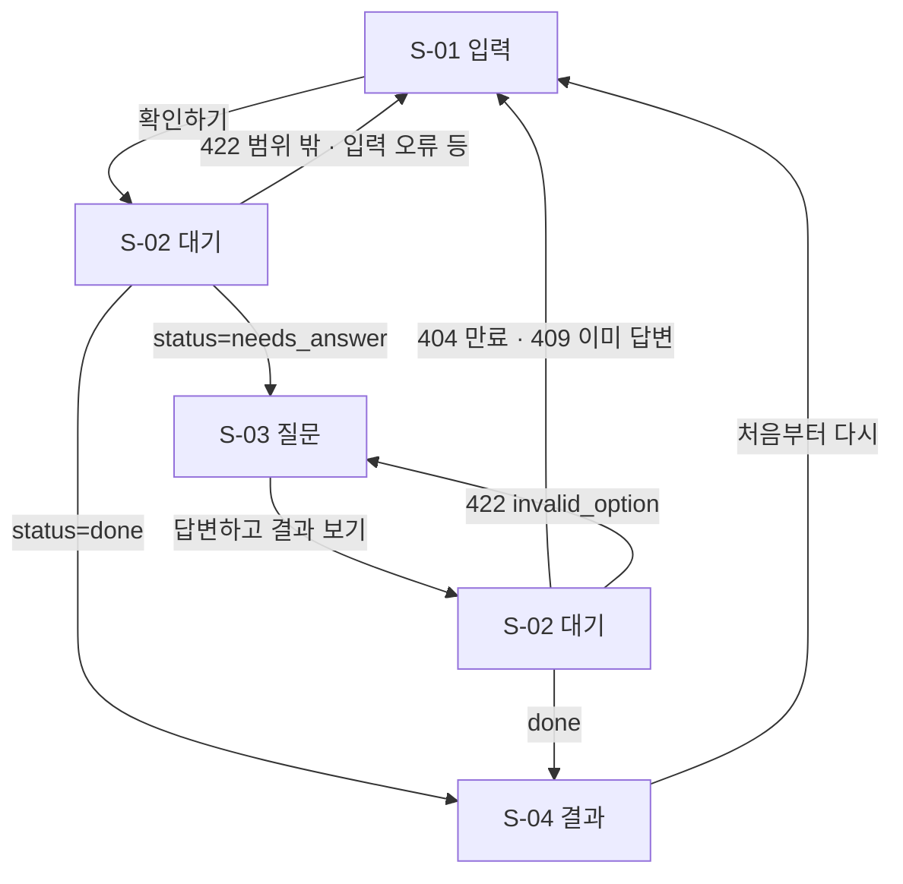

# 화면설계서

작성: 2026-10-28 · 구현 기준: `frontend/` (커밋 `b6c76d2` 이후) · 관련 이슈 #30 · 관련 요구사항 FR-01, FR-11, FR-13~FR-17

> 이 문서의 화면 구성은 **구현된 화면과 일치하도록 코드에서 확인해 작성**했다. 저장소 문서에는 이미지를 넣지 않는다(2026-10-21 결정) — 와이어프레임은 텍스트로, 흐름도는 텍스트 기반 Mermaid 로 그린다. 화면 캡처는 로컬(`docs/screenshots/`, git 제외)에서 제출 파일로 따로 쓴다.

## 1. 개요

| 항목 | 내용 |
|---|---|
| 서비스 | 교통사고 과실비율 확인 — 사고 당사자를 위한 근거 설명형 2차 의견 |
| 사용자 | 자동차 대 자동차(이륜차 포함) 사고 당사자. 보행자·자전거·킥보드 사고는 지원하지 않음 |
| 기술 | 순수 HTML / CSS / JS (빌드 도구 없음), `file://` 로 열어도 동작 (`?api=` 로 백엔드 주소 변경) |
| 파일 | `frontend/index.html`(마크업), `frontend/css/style.css`(스타일), `frontend/js/app.js`(동작) |
| 디자인 원칙 | ① 단정하지 않고 **범위와 조건**으로 보여 준다 ② 질문 화면에서는 **결과를 숨긴다** ③ 사용자의 답은 **진술**로만 취급해 표기한다 ④ 항상 **참고용·법적 효력 없음** 고지를 둔다 |

### 화면 목록

| 화면 ID | 이름 | 목적 | API |
|---|---|---|---|
| S-01 | 입력 | 사고 상황을 받는다 | — |
| S-02 | 대기 | 분석(약 30초~2분) 동안 상태를 알린다 | `POST /v1/assess`, `POST /v1/assess/{id}/answer` 진행 중 |
| S-03 | 질문 | 정황에 없는 사실 때문에 결과가 크게 갈릴 때 결과를 숨긴 채 묻는다 | `POST /v1/assess` 응답(`needs_answer`) |
| S-04 | 결과 | 과실 범위·이유·기준표·증거·고지를 보여 준다 | `POST /v1/assess` 또는 `/answer` 응답(`done`) |
| (공통) | 헤더·단계 표시·오류 알림·푸터 | 모든 화면에 공통 | — |

공방 뷰(양측 논증을 실시간으로 보는 내부·보조 화면, #14)는 Stretch 로 보류했다.

## 2. 화면 흐름



단계 표시(3단계): **사고 입력 → 확인 질문 → 결과 보기**. S-01·S-02 는 1단계(답변 뒤 대기 중에도 1단계 표시 그대로), S-03 은 2단계, S-04 는 3단계로 표시하고 지난 단계는 체크로 바꾼다.

## 3. 공통 영역

```
┌──────────────────────────────────────────────────────────────┐
│ [⚖] 과실비율 확인                                    [☾/☀]  │  ← 헤더(그라데이션), 테마 버튼
│                                                              │
│ 교통사고 과실비율,                                           │
│ 근거와 함께 확인하세요                                       │
│ 사고 상황을 적으면 ... 참고용이며 법적 효력은 없습니다.      │
│ (인정기준 108개 도표 기반) (범위와 조건으로 안내) (판단 근거 공개) │  ← 특징 칩
├──────────────────────────────────────────────────────────────┤
│  ①사고 입력      ②확인 질문      ③결과 보기                 │  ← 단계 표시
├──────────────────────────────────────────────────────────────┤
│ [오류 알림 영역: role=alert, ×로 닫기]                       │
│ ... 화면별 본문 (S-01 ~ S-04) ...                            │
├──────────────────────────────────────────────────────────────┤
│ 기준표 출처: 손해보험협회 과실비율정보포털 · 참고용 고지     │  ← 푸터
└──────────────────────────────────────────────────────────────┘
```

| 요소 | 규칙 |
|---|---|
| 테마 버튼 | 시스템 설정(라이트/다크)을 따르다가 누르면 반대로 바꾸고 브라우저에 기억. 저장소를 못 쓰면 기억만 생략 |
| 단계 표시 | `aria-current="step"` 로 현재 단계 표시, 완료 단계는 체크 |
| 오류 알림 | 오류 문구를 표시, `role="alert"`. 새 요청을 시작하면 지운다 |
| 본문 건너뛰기 | 키보드 사용자를 위한 "본문으로 건너뛰기" 링크 |

## 4. 화면별 설계

### S-01 입력

```
┌──────────────────────────────────────────────┐
│ 어떤 사고였나요?                             │
│                                              │
│ 사고 상황 설명 (필수)              0 / 2000  │
│ ┌──────────────────────────────────────────┐ │
│ │ 나의 차량은 A, 상대 차량은 B로 적어 주세요.│ │  ← placeholder(예시 문장)
│ │ 예) 제가(A) 1차로에서 직진 중인데 ...      │ │
│ └──────────────────────────────────────────┘ │
│ 10자 이상 적어 주세요. 자동차 대 자동차 ...   │
│                                              │
│ 예시로 시작해 보기                           │
│ (차로 변경)(직진 vs 좌회전)(후방 추돌)(주차장 후진) │
│                                              │
│ ▸ 알고 있는 정보를 더 적기 (선택)          + │
│ ┌ 차로 상태 ─────────────────────────────┐   │  ← 펼치면
│ │ [ 내 차량 속도 ] [ 상대 차량 속도 ]    │   │
│ └──────────────────────────────────────────┘ │
│                                              │
│ [ 과실비율 확인하기  → ]  (10자 미만이면 비활성) │
└──────────────────────────────────────────────┘
```

| 요소 | 규칙 |
|---|---|
| 사고 상황 설명 | 필수, 10~2000자. 나=A, 상대=B 로 적도록 안내. 글자 수 카운터, 1~9자일 때 카운터를 경고색으로 |
| 제출 버튼 | **공백 제외 10자 미만이면 비활성** |
| 예시 칩 4개 | 차로 변경 / 직진 vs 좌회전 / 후방 추돌 / 주차장 후진. 누르면 입력창에 예시 문장을 채운다 (사용자가 고쳐 쓸 수 있음) |
| 선택 정보 | 접이식. 차로 상태(최대 200자), 내 차량 속도·상대 차량 속도(0~300 km/h). "모르면 비워 두세요, 추측하면 결과가 달라질 수 있어요" 안내 |
| 제출 | `POST /v1/assess` (`description`, `lane_info`, `speed_a_kmh`, `speed_b_kmh`). 신호 상태 선택은 두지 않는다 — 신호 같은 사실은 질문 단계에서 묻는다 |

### S-02 대기

```
┌──────────────────────────────────────────────┐
│                    ◜ ◝                       │  ← 회전 링
│         사고 상황을 분석하고 있어요            │  ← 제출 직후 문구
│  여러 관점으로 꼼꼼히 검토하느라 1~2분 정도     │
│  걸릴 수 있어요. 창을 닫지 말고 기다려 주세요. │
│  ▓▓▓▓░░░░░░░░░░░░░░                          │  ← 불확정(왔다갔다) 진행 바
│                 12초 경과                    │
└──────────────────────────────────────────────┘
```

- 문구: 처음 요청 "사고 상황을 분석하고 있어요", 답변 후 "답변을 반영하고 있어요".
- **실제 진행 상태를 알 수 없으므로 단계별 진행 문구는 넣지 않았다.** 불확정 진행 바와 경과 시간(초)만 보여 준다.
- 실측 소요 시간은 시나리오당 평균 약 35~47초(과거 측정은 100초 이상, 원인 미확인)이며 안내 문구는 여유 있게 "1~2분"으로 둔다.

### S-03 질문

```
┌──────────────────────────────────────────────┐
│ ⓘ 정확한 검토를 위한 질문입니다. 답변은 사실로   │  ← 안내 박스(노랑)
│   확인되지 않은 진술로 취급되며, 모르면 '모름'을 │
│   고르셔도 됩니다.                            │
│                                              │
│ 상대 차량이 교차로에 진입할 때 신호등의 색깔이   │  ← 질문(사실 질문)
│ 무엇이었나요?                                 │
│                                              │
│  ○ 녹색 신호에 진입했다                        │  ← 보기(서버가 섞은 순서 그대로)
│  ○ 황색 신호에 진입했다                        │
│  ○ 적색 신호에 진입했다                        │
│  ┈┈┈ 잘 모르겠거나 해당하는 보기가 없다면 ┈┈┈  │
│  ◌ 모름 / 확실하지 않음                        │  ← 점선 카드(시스템이 붙임)
│  ◌ 위의 보기에 해당하는 것이 없음              │
│                                              │
│ [ 답변하고 결과 보기 ]  (선택 전에는 비활성)    │
└──────────────────────────────────────────────┘
```

| 요소 | 규칙 |
|---|---|
| 질문·보기 | 서버가 준 문구를 그대로 표시. **과실비율·도표번호·증거는 이 화면에 없다**(서버가 주지 않음). 문자열은 텍스트로만 넣어 HTML 이 실행되지 않는다 |
| 보기 순서 | 서버가 `seed` 로 섞은 순서 그대로. 화면에서 다시 섞거나 정렬하지 않는다 |
| 선택 상태 | **처음에는 아무것도 선택하지 않는다.** 선택하면 카드 강조, 제출 버튼 활성 |
| 특수 선택지 | "모름"(id -1), "해당하는 보기가 없음"(id -2)은 구분선 아래 점선 카드로 따로 표시. 모름은 보기 안의 범위만, 해당 없음은 범위를 좁히지 않는 결과로 이어진다 |
| 제출 | `POST /v1/assess/{session_id}/answer` (`option_id`, `seed`). 세션당 1회 |
| 접근성 | 보기는 라디오 그룹(방향키 이동), 화면 전환 시 질문 제목으로 포커스 이동 |

### S-04 결과

```
┌──────────────────────────────────────────────┐
│           나의 과실 (내 차량 기준)              │
│                0 ~ 10%  범위                   │  ← 큰 숫자 (한 값이면 "40%")
│  [▓▓░░░░░░░░░░░░░░░░░░░░░░░░░░]               │  ← 나(파랑) / 상대(주황) 막대, 범위는 사선
│  ● 나 0 ~ 10%                  ● 상대 90 ~ 100% │
│  ┃ 사용자 진술 기준: '질문' → 녹색 신호였다      │  ← 질문에 답했을 때만
│  ┃ (사실로 확인된 것이 아닙니다)                 │
├──────────────────────────────────────────────┤
│ ⚠ 검토 의견이 갈린 사고예요. ...확인해 보세요.   │  ← uncertain 일 때만
├──────────────────────────────────────────────┤
│ 이렇게 판단했어요                             │
│ (설명 문단: 모델 문장이 검증을 통과하면 사용,    │
│  아니면 코드가 만든 문장)                      │
│ 적용된 기준표                                 │
│  차6-1 신호기 있는 도로 직진 대 ...             │
│  도표가 다루는 상황 / 관련 법규                 │
│  [▓▓▓▓░░░░░░░] 기본 과실비율 · 나 40   상대 60  │
├──────────────────────────────────────────────┤
│ 판단을 바꿀 수 있는 증거  (확인해 보세요)        │
│  ✓ 블랙박스 영상 ... ✓ 교차로 신호 주기 기록      │
├──────────────────────────────────────────────┤
│ 참고 (다른 도표도 가능하나 결과 차이는 작음 등)    │  ← 있을 때만
├──────────────────────────────────────────────┤
│ 이 결과는 참고용이며 법적 효력이 없습니다. ...    │
│ [ 결과 복사하기 ]  [ 처음부터 다시 ]            │
└──────────────────────────────────────────────┘
```

| 요소 | 데이터(필드) | 규칙 |
|---|---|---|
| 큰 숫자 | `my_fault_low/high` | 같으면 한 값, 다르면 "하한 ~ 상한%" + "범위" 표시. 숫자는 0부터 올라가는 애니메이션(움직임 줄이기 설정이면 즉시 표시) |
| 막대 | 위 값, `other_fault_*` | 나 구간은 채움, 범위 구간은 사선 무늬. 범례에 나/상대 값 |
| 진술 표기 | `assumption` | 있을 때만 표시. 사용자의 답이 **확인된 사실이 아님**을 항상 밝힌다 |
| 주의 박스 | `uncertain` | 참이면 "검토 의견이 갈린 사고, 보험사 설명이나 전문가 상담으로 확인 권장" |
| 설명 | `summary` | 서버가 검증한 문장. 모름·해당 없음이면 고정 안내 문장(보기별 결과·도표 비공개) |
| 기준표 카드 | `chart_basis[]` | 도표번호·이름·상황·법규·기본 과실비율 막대. **모름/해당 없음이면 비어 있다**(보기별 결과 노출 방지) |
| 증거 | `evidence_to_check[]` | 체크 아이콘 목록 |
| 참고 | `other_possibilities` | 질문하지 않은 경우의 참고 문구, 있을 때만 |
| 고지 | `disclaimer` | 항상 표시 |
| 결과 복사하기 | — | 결과 요약 텍스트를 클립보드에 복사(권한이 없으면 대체 방식), 성공/실패 문구를 1.8초 표시 |
| 처음부터 다시 | — | 입력 화면으로 이동, 입력한 사고 설명은 유지 |

## 5. 오류·예외 처리

| 상황 | 서버 응답 | 사용자 문구(요지) | 이동 |
|---|---|---|---|
| 지원 범위 밖 사고 | 422 `out_of_scope` | 자동차 대 자동차만 확인 가능 + 포털 안내 | S-01 |
| 입력 형식 오류 | 422 (검증) | "입력을 확인해 주세요" + 사유 | S-01 |
| 질문 시간 만료·없는 요청 | 404 | 질문 시간이 지났거나 찾을 수 없음, 처음부터 다시 | S-01 |
| 이미 답변한 요청 | 409 | 이미 답변함, 처음부터 다시 | S-01 |
| 선택이 올바르지 않음 | 422 `invalid_option` | 다시 선택해 달라 | S-03 (세션 유지) |
| 서버 혼잡 | 503 | 잠시 후 다시 시도 | S-01 |
| 서버 연결 실패 | (네트워크) | 백엔드가 실행 중인지 확인 | 직전 화면 |
| 그 밖의 오류 | 기타 | "오류가 발생했어요 (HTTP 상태)" | S-01 |

## 6. 반응형·테마·접근성

| 항목 | 기준 | 확인 상태 |
|---|---|---|
| 폭 | 본문 최대 720px 가운데 정렬. 560px 이하에서 단계 표시를 세로형으로, 버튼을 전체 폭으로 | 375px 폭에서 가로 스크롤 없음 확인 |
| 긴 문자열 | 띄어쓰기 없는 긴 영문·URL 도 줄바꿈 (`overflow-wrap`) | 스트레스 문자열로 확인 |
| 입력창·버튼 | 입력창 글자 크기 16px (iOS 자동 확대 방지), 버튼 높이 48px 이상 | 확인 |
| 다크 모드 | 시스템 설정 + 수동 전환 | 확인 |
| 키보드 | 모든 조작은 키보드로 가능, 보기는 라디오 그룹, 포커스 링 표시, 화면 전환 시 제목으로 포커스 이동 | 구조 점검(스크린 리더로 읽어 보지는 못함) |
| 움직임 | `prefers-reduced-motion` 이면 애니메이션을 사실상 끔 | 적용 |
| 인쇄 | 결과 화면만 인쇄되도록 입력·질문·헤더 숨김 | 적용(출력 확인은 못 함) |

## 7. 요구사항 추적

| 요구사항 | 이 문서의 화면 |
|---|---|
| FR-01 사고 상황 자유 서술 입력 | S-01 |
| FR-13 지원 범위 밖 사고 안내 | S-01 안내문, §5 오류 처리 |
| FR-14 결정적 사실을 묻는 질문 | S-03 |
| FR-15 질문 화면에서 결과 숨김·보기 순서 무작위·"모름" 허용 | S-03 |
| FR-16 범위·조건 표시, 진술 표기, 증거 안내 | S-04 |
| FR-17 정밀 심사 플래그 | 사용자 화면에는 노출하지 않고 `uncertain` 주의 박스로만 표현(내부 플래그·사유는 내부용) |
| FR-11 최종 리포트 화면 | S-04 |
| FR-10 라운드별 공방 실시간 뷰 | **미구현**(Stretch, 내부·보조 화면) |

## 8. 한계와 남은 일

- 실제 휴대폰, Safari 등 다른 브라우저, 스크린 리더로는 확인하지 못했다(#29).
- 질문·결과 화면은 가짜 서버 응답으로 확인했다. 실제 모델이 만든 질문으로 전 구간을 돌린 화면 검증은 실모델 검증(#26)과 함께 한다.
- 서버 응답이 오래 걸리는 동기 방식이라 대기 화면이 길다. 작업 큐·진행 상태 표시는 #28 에서 검토한다.
- 폰트는 시스템 폰트(Pretendard 우선)이며 웹폰트를 불러오지 않는다.
