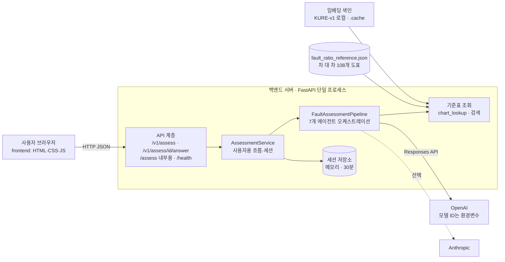
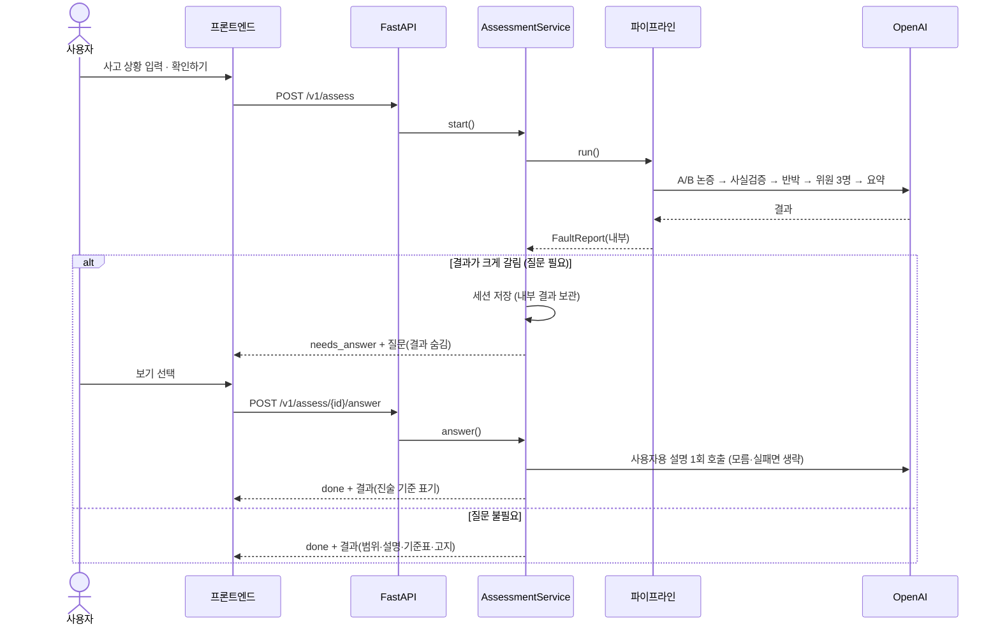

# 시스템 구성도

작성: 2026-10-28 · 구현 기준: 커밋 `56fddb2` 이후 · 관련 이슈 #30 · 상세 구조는 [07_AI_시스템_아키텍처.md](07_AI_시스템_아키텍처.md), API 설계는 [../USER_API_DESIGN.md](../USER_API_DESIGN.md)

> 저장소 문서에는 이미지를 넣지 않는다(2026-10-21 결정). 구성도는 텍스트 기반 Mermaid 다이어그램과 표로 그렸다(GitHub 에서 렌더링됨).

## 1. 한눈에 보는 구성



- 서버는 **하나의 프로세스**이고 데이터베이스가 없다. 기준표는 정적 JSON, 임베딩 색인은 파일 캐시, 사용자 세션은 메모리다.
- LLM 은 외부 API(OpenAI 기본, Anthropic 선택)이며 모델을 학습하지 않는다. 기준표 도구 호출, 프롬프트, 검증 코드로 품질을 확보한다.
- 기준표 수집 스크립트(`scripts/scrape_knia_charts.py`)만 외부 포털에 접속하며 **서비스 실행 중에는 포털을 호출하지 않는다.**

## 2. 요청 처리 순서



## 3. 구성 요소

| 구성 요소 | 위치 | 역할 | 기술 |
|---|---|---|---|
| 프론트엔드 | `frontend/index.html`, `css/style.css`, `js/app.js` | 입력·대기·질문·결과 화면 ([08_화면설계서.md](08_화면설계서.md)) | 순수 HTML/CSS/JS |
| API 계층 | `backend/app/main.py` | 엔드포인트, 오류 코드 변환, CORS | FastAPI, pydantic |
| 사용자용 흐름 | `core/user_flow.py`, `user_summary.py`, `user_text.py`, `clarify.py`, `sessions.py` | 질문 숨김·답변 반영·설명 생성과 검증·세션 | Python |
| 파이프라인 | `core/pipeline.py` | 에이전트 호출 순서·병렬·실패 처리 | asyncio |
| 에이전트 7종 | `agents/` | A/B차량측, 사실검증, 검토위원 3종(기준표·현장 정황·유사사례), 진행 | 프롬프트 + 도구 호출 |
| LLM 클라이언트 | `core/llm_client.py` | OpenAI Responses API / Anthropic 공통 인터페이스, 구조화 출력 검증·재시도, 429 대기 재시도, 사용량 집계, mock 모드 | openai, anthropic SDK |
| 기준표 조회 | `core/chart_lookup.py`, `chart_tools.py`, `embedding_index.py` | 키워드·임베딩·hybrid 검색, 에이전트용 도구(search_charts/get_chart) | 2-gram+IDF, KURE-v1 |
| 검증 코드 | `core/citation_check.py`, `verdict_check.py`, `scope_check.py` | 인용 검증, 위원 값 검증(도표 기본 비율 대조), 지원 범위 판별 | 규칙 기반 |
| 데이터 | `app/data/fault_ratio_reference.json` | 108개 도표(경우·가감요소·법규·판례) | JSON |
| 평가 도구 | `app/evaluation/`, `scripts/run_scenarios.py`, `run_baseline.py` | 시나리오 일괄 평가, 포털식 baseline 비교 | Python |

## 4. 파이프라인 한 번의 실행

```
정황 입력
  └─ 범위 판별(보행자·자전거·킥보드·단독사고는 중단)
  └─ 후보 도표 검색(상위 5개)
  1라운드  A차량측 ∥ B차량측     (도구 호출로 기준표 조회)
  사실검증 (규칙 기반 + LLM)
  2라운드  A차량측 ∥ B차량측     (반박)
  검토위원 3명 병렬              (기준표 적용 · 현장 정황 · 유사사례)
  진행 에이전트                  (위원 중앙값 집계, 숫자 헤더는 코드가 생성, 요약)
  질문 계획 (조건 충족 시)       (위원이 모호함 신호를 보일 때만)
  보기 점검 (질문이 생성될 때)   (정황과 모순되는 보기 제외, 점검 실패 시 질문 폐기)
  사용자용 설명 (질문이 없을 때) (내부 정보를 주지 않는 별도 호출 + 검증)
```

| 측정 항목 (개발용 13건, gpt-4.1) | 값 |
|---|---|
| LLM 호출 수 | 시나리오당 약 10~17회 (평균 약 11) |
| 토큰 | 시나리오당 입력 약 6.5만 / 출력 약 0.7만 |
| 소요 시간 | 최근 측정 평균 약 34~47초(이전에는 100초 이상이었으며 원인 미확인) |
| 비용 | 단가가 확인되지 않아 코드에 고정하지 않음. 평가 도구가 단가 인자로 계산 |

호출은 대부분 직렬 구간(1라운드 → 사실검증 → 2라운드 → 위원 → 요약)이라 시간이 길다. 위원 3명 병렬 호출이 분당 토큰 한도에 걸리는 경우를 위해 429 응답이면 서버가 안내한 시간만큼 기다려 다시 시도한다.

## 5. 데이터 저장

| 데이터 | 위치 | 내용·수명 | 비고 |
|---|---|---|---|
| 기준표 | `backend/app/data/fault_ratio_reference.json` | 108개 도표, 정적 | 출처 표기, **공개 재배포 금지**(#23) |
| 임베딩 색인 | `backend/.cache/` (git 제외) | 도표 텍스트 임베딩 `.npy` | 최초 사용 시 생성 |
| 사용자 세션 | 서버 메모리 | 질문이 필요한 요청의 내부 결과. **30분 만료, 최대 200개, 답변 1회 후 내부 결과 삭제** | 서버 재시작 시 소멸 |
| 평가 결과 | `backend/eval/results/` (git 제외) | 시나리오별 결과 JSON | 사고 정황 문구가 포함될 수 있음 |
| 비밀값 | `backend/.env` (git 제외) | API 키 | `.env.example` 에 항목만 |
| 사용자 입력 | 저장하지 않음(세션 메모리 제외) | 요청 처리 중에만 사용 | 단, 외부 LLM 으로 전송됨(아래) |

## 6. 외부 연동과 개인정보

| 대상 | 방향 | 내용 | 주의 |
|---|---|---|---|
| OpenAI API | 서버 → 외부 | **사용자가 입력한 사고 정황**과 기준표 내용이 프롬프트로 전송됨 | 개인정보·식별 정보를 적지 않도록 안내하고, 서비스 공개 시 개인정보 처리 고지를 검토해야 함 |
| Anthropic API | 서버 → 외부 | 선택 사용 | 기본은 OpenAI |
| Hugging Face | 서버 → 외부 | 임베딩 모델(KURE-v1) 최초 다운로드 | 이후 로컬 실행 |
| 손해보험협회 포털 | 수집 스크립트 → 외부 | 기준표 수집(1회성) | 서비스 중 호출 없음 |

## 7. 설정(환경 변수)

| 변수 | 기본 | 설명 |
|---|---|---|
| `LLM_PROVIDER` | `openai` | `openai` 또는 `anthropic` |
| `OPENAI_API_KEY` / `OPENAI_MODEL` | 빈 값 | 키가 없으면 **mock 모드**(실제 호출 없이 전체 흐름 실행). 모델 ID 는 코드에 고정하지 않고 지정 |
| `OPENAI_REASONING_EFFORT` | 빈 값 | 추론 모델 사용 시 깊이 조절 |
| `ANTHROPIC_API_KEY` / `LLM_MODEL` | 빈 값 / `claude-opus-5-5` | Anthropic 사용 시 |
| `CHART_SEARCH_MODE` | `keyword` | `keyword` / `embedding` / `hybrid` (임베딩 불가 시 키워드로 자동 대체) |
| `INTERNAL_API_ENABLED` | `true` | 내부·개발용 `/assess` (보기별 도표·과실이 그대로 나감). **사용자에게 공개하는 환경에서는 `false`** |
| `PORT` | `8000` | 서버 포트 |

## 8. 실행 구성

| 환경 | 구성 | 상태 |
|---|---|---|
| 로컬 개발 | `uvicorn app.main:app --port 8000` + `frontend/index.html` 을 파일로 열거나 정적 서버 | 사용 중 |
| 키 없는 개발 | mock 모드로 전체 흐름 실행 (질문은 생성되지 않음) | 사용 중, 테스트 283개 |
| 배포 | **미구성** (제안: 단일 서버에 백엔드와 정적 프론트를 함께 올리는 최소 구성) | 미구현 |

## 9. 보안·운영 고려와 한계

| 항목 | 현재 | 한계·후속 |
|---|---|---|
| API 접근 | CORS 전체 허용(`*`), 인증 없음 | 개발용. 배포 시 허용 도메인 제한, 호출 제한(#28) |
| 내부 API | 설정으로 차단 가능 | 배포 시 반드시 `false` |
| 세션 | 추측할 수 없는 무작위 토큰(32자 이상), 답변 1회, 만료 | 메모리 방식이라 재시작·다중 프로세스 미지원(#28) |
| 응답 시간 | 동기 호출, 수십 초~2분 | 작업 큐·진행 표시(#28) |
| 비용 | 요청당 LLM 호출 10~17회 | 호출 수·토큰은 평가 도구가 집계, 단가는 별도 입력 |
| 장애 대응 | 429 대기 재시도, 위원 일부 실패 허용(최소 2명), 질문·요약 실패 시 본 결과 유지 | 외부 API 전면 장애 시 서비스 불가(대체 경로 없음) |
| 같은 정황 반복 호출 | 보기별 결과를 알아내는 우회 완화 장치 없음 | 호출 제한 검토(#28) |

## 10. 검증 상태

- 자동 테스트 283개 통과(1개 건너뜀). 외부 호출 없이 실행되며 실제 모델 테스트는 선택 실행이다.
- 실모델로는 개발용 시나리오에서 평가했다. 질문 단계와 설명 검증의 실모델 품질은 #26 에서 계속 측정한다.
- 시스템 전체를 배포 환경에서 검증하지는 않았다.
